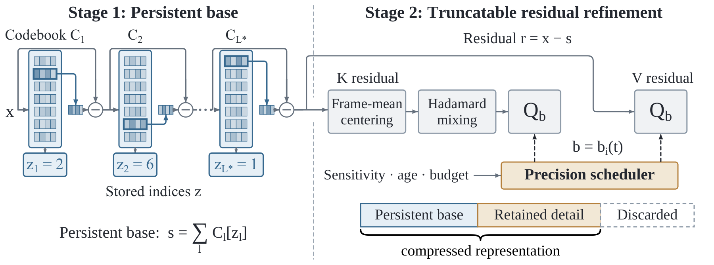
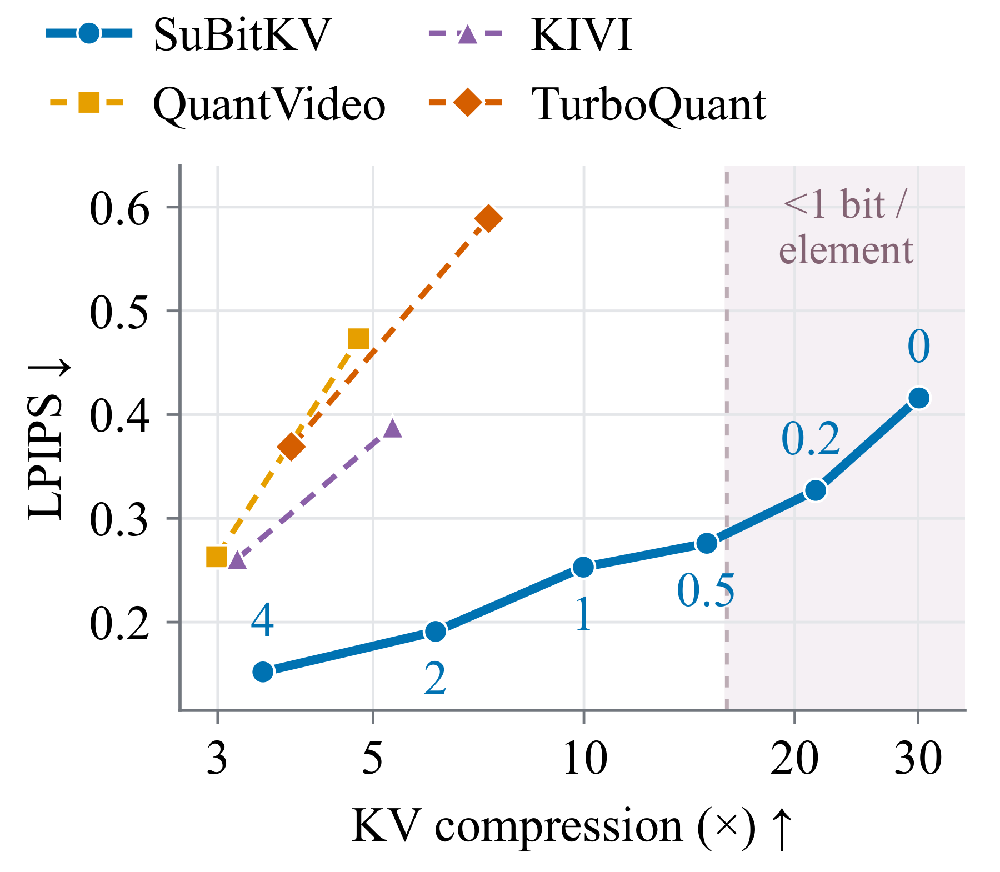
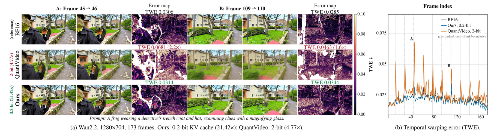

<h1 align="center">SuBitKV</h1>
<p align="center"><strong>Sub-Bit KV Cache Compression for Autoregressive Video Generation</strong></p>

<p align="center">
  <a href="#quick-start"></a>
  <a href="docs/subbitkv.md"></a>
  <a href="https://github.com/linbowen0719-beep/ICLR2027_COMPRESS"></a>
  <a href="LICENSE"></a>
</p>

<p align="center">
  <a href="#highlights">Highlights</a> ·
  <a href="#method-overview">Method</a> ·
  <a href="#installation">Installation</a> ·
  <a href="#download-models">Models</a> ·
  <a href="#quick-start">Quick start</a> ·
  <a href="#results">Results</a> ·
  <a href="#citation">Citation</a>
</p>

> **Keep the history. Reclaim the precision.** SuBitKV preserves a compact RVQ
> base for every retained cache entry and progressively removes residual detail
> as the cache grows. The manuscript reports **21.42× KV-cache compression** on
> Wan2.2 at `Q=0.2`, reaching **30.09×** at `Q=0`. [Results and protocol →](#results)

<p align="center">
  <a href="assets/subitkv_teaser.png">
    
  </a>
</p>

The video thumbnails are illustrative. Compression figures are Wan2.2
manuscript measurements; see [Results](#results) for the evaluation protocol.

## Highlights

- **Sub-bit cache storage.** Shared RVQ codebooks represent full KV vectors using compact indices, preserving a persistent approximation of the retained history.
- **Progressive precision.** Allocate more residual detail when capacity is available, then truncate it as new chunks arrive, without re-encoding old cache entries.
- **Unchanged generator weights.** Fit codebooks and calibration statistics once, then reuse them across prompts and residual budgets `0 / 0.2 / 0.5 / 1 / 2 / 3 / 4`.
- **Three model integrations.** Wan2.2 5B, Self-Forcing, and HY-WorldPlay 8B.
- **One workflow.** Download → collect KV → calibrate → infer → evaluate, with all hyperparameters in [`configs/subbitkv.yaml`](configs/subbitkv.yaml).

`Q` is the nominal **residual** budget per KV element. Physical storage also
includes the RVQ base and other overhead; `Q=0` still retains the base.

## Method overview

<p align="center">
  <a href="assets/paper/method_overview.pdf">
    
  </a>
</p>

1. **Build the base.** Represent each KV vector with indices into shared RVQ codebooks.
2. **Refine the reconstruction.** Encode the remaining error with truncatable residual codes.
3. **Allocate the bits.** At each chunk admission, deduct the accumulated RVQ base cost from the memory budget and allocate the remaining capacity using calibrated importance and distortion.

When attention reads the history, it reconstructs each entry from the persistent
base and the retained refinement. See the [workflow guide](docs/subbitkv.md)
for calibration, sequential DP, and joint schedule optimization.

## Installation

For video generation, use **Linux, Python 3.12, PyTorch 2.8.0, an NVIDIA CUDA
GPU, and FFmpeg**. Existing Wan and HY native inference smoke runs used an
RTX 6000 Ada with 48 GiB of VRAM; calibration requirements depend on the workload.

```bash
git clone https://github.com/linbowen0719-beep/SuBitKV.git
cd SuBitKV

conda create -n subbitkv python=3.12 -y
conda activate subbitkv
python -m pip install -e '.[release]'
conda install -c conda-forge ffmpeg -y
```

See [installation details](docs/installation.md) for attention backends and GPU
checks. Run commands from the repository root. To try scheduling without a GPU
or package installation, jump to [Generate a schedule](#generate-a-schedule).

## Download models

Start with Wan2.2. The downloader fetches the base model and the HY-WorldPlay
Wan checkpoints from Hugging Face and records their revisions and hashes.

```bash
# 0. Download model checkpoints.
python scripts/subbitkv.py download-models --model wan2_2_5b --run-id wan-demo --resume --execute
```

| Model | `--model` | Input |
| --- | --- | --- |
| Wan2.2 5B through HY-WorldPlay | `wan2_2_5b` | Text |
| Self-Forcing | `self_forcing` | Text |
| HY-WorldPlay 8B | `hyworldplay_8b` | Text + [conditioning images](docs/subbitkv.md#conditioning-images-for-hy-worldplay) |

Use the selected model name consistently across all stages. RVQ codebooks,
residual codec weights, and KV captures are produced by the next two steps.
This checkout includes HY scheduling constants; a pretrained codec bundle for
video inference is not included.

## Quick start

### Run Wan

After downloading the model, run the following commands. They share the run ID
`wan-demo` and use the default `smoke` profile: **two calibration prompts and one
evaluation prompt**, at the model's full video length.

```bash
# 1. Generate BF16 calibration samples and capture their KV caches locally.
python scripts/subbitkv.py collect --model wan2_2_5b --run-id wan-demo --resume --execute

# 2. Fit codebooks, residual codecs, importance weights, and bit schedules.
python scripts/subbitkv.py calibrate --model wan2_2_5b --run-id wan-demo --resume --execute

# 3. Generate a BF16 reference and a compressed video at Q=0.5.
python scripts/subbitkv.py infer --model wan2_2_5b --run-id wan-demo --budget 0.5 --resume --execute

# 4. Evaluate PSNR, SSIM, LPIPS, TWE, and VBench.
python scripts/subbitkv.py metrics --model wan2_2_5b --run-id wan-demo --resume --execute
```

**Remove `--execute` to preview a command.** `--resume` verifies and skips
completed work. Keep the same configuration and run ID across stages; use a new
run ID after changing prompts or hyperparameters.

The default evaluation prompt is the frog detective from the paper figure:

> A frog wearing a detective's trench coat and hat, examining clues with a magnifying glass

To check BF16 generation before calibrating, run this after downloading:

```bash
python scripts/subbitkv.py infer --model wan2_2_5b --run-id wan-demo --reference-only --resume --execute
```

### Generate a schedule

The saved HY-WorldPlay calibration constants let you try bit allocation with
**Python 3.10+ only**, without downloading models or running calibration:

```bash
python scripts/subbitkv_schedule.py --budget 0.5 --output outputs/hy_avg0p5.json
```

This prints the K/V schedules and each step's remaining capacity, and saves a
runtime profile. Change `--budget` to explore another budget, or omit `--output`
to print without saving. Default optimization is sequential DP; `--solver milp`
uses joint optimization and requires SciPy.

The bundled constants are HY-specific. Below 1 bit, this example uses the
recorded, unmeasured `D(0)=4×D(1)` estimate and marks the profile as provisional.
See [saved constants](docs/subbitkv.md#generate-schedules-from-saved-calibration-constants)
for custom calibration inputs and estimate handling.

### Find your outputs

The Wan example writes to `outputs/subbitkv/wan2_2_5b/wan-demo/`:

| Location | Contents |
| --- | --- |
| `models/` | Downloaded checkpoints and pinned revisions |
| `capture/` | Calibration KV tensors and sample records |
| `bundle/` | Codebooks, codec weights, and frozen schedules |
| `videos/bf16/`, `videos/avg0p5/` | Reference and compressed generation attempts |
| `videos.json` | Exact video paths and file hashes |
| `metrics/attempt_01/summary.csv` | First evaluation summary |
| `metrics/attempt_01/per_video.csv` | Per-video measurements |

Each model attempt has a `run.log`. See [outputs and troubleshooting](docs/subbitkv.md#outputs-and-troubleshooting)
for resuming work, locating videos, and diagnosing errors.

## Results

<p align="center">
  <a href="assets/paper/wan_quality_compression.pdf">
    
  </a>
</p>

**Wan2.2-5B, selected manuscript results.** Lower LPIPS and TWE are better;
higher PSNR and compression are better.

| Method | Setting | KV compression ↑ | PSNR ↑ | LPIPS ↓ | TWE ↓ |
| --- | --- | ---: | ---: | ---: | ---: |
| BF16 | Reference | 1.00× | — | — | 0.0173 |
| QuantVideo | INT2 | 4.77× | 13.94 | 0.473 | 0.0230 |
| KIVI | INT2 | 5.33× | 15.24 | 0.388 | 0.0193 |
| TurboQuant | K2/V2 | 7.31× | 12.88 | 0.589 | 0.0264 |
| **SuBitKV** | **Q=0.5** | **14.98×** | **20.19** | **0.276** | **0.0190** |
| **SuBitKV** | **Q=0.2** | **21.42×** | **18.32** | **0.327** | **0.0194** |
| **SuBitKV** | **Q=0** | **30.09×** | **16.30** | **0.416** | **0.0244** |

At `Q=0.2`, the reported compression corresponds to approximately **0.747
effective bits per original KV element** (`16 / 21.42`). Quality uses 973 samples;
TWE uses 10 videos per setting. Compression includes shared codebooks, metadata,
and cache-related workspace. These results use the manuscript's frozen
protocol. The quick start performs fresh calibration and records its own results.

<p align="center">
  <a href="assets/paper/wan_temporal_comparison.pdf">
    
  </a>
</p>

**More compact history, smoother transitions in this example.** The paper's
Wan2.2 comparison shows frame pairs after chunk boundaries, motion-aligned error
maps, and temporal warping error (TWE, lower is better). Click any paper figure
for its original PDF.


Paper figures and table values come from the author's manuscript snapshot
`4c10265`. See [figure sources and evaluation notes](assets/paper/README.md)
for the original PDFs, source paths, and accounting details.

## Configuration

Edit [`configs/subbitkv.yaml`](configs/subbitkv.yaml) before starting a run.
Paths are relative to the repository root.

| Change | Where |
| --- | --- |
| Demo prompt | [`assets/default_prompt.txt`](assets/default_prompt.txt), or `profiles.smoke.eval_prompts` |
| Calibration prompts | `data.train_prompts` and `profiles.smoke.train_count` |
| GPU | `runtime.gpus` for generation/training; `runtime.device` for codec fitting and metrics |
| Seed | `models.wan2_2_5b.seed` (or the corresponding model section) |
| Inference budget | `infer --budget 0.5`; omit `--budget` to run all configured budgets |
| Larger evaluation | `--profile full` on every stage: 20 calibration and 10 evaluation prompts |
| Metrics | `metrics.enabled` |
| Output directory | `runtime.root`, or the `SUBBITKV_ROOT` environment variable |

For GPU 1, set `runtime.gpus: [1]` and `runtime.device: cuda:1`. Prompt files
contain one prompt per nonempty line. The full profile has its own evaluation
prompt file, separate from the demo.

## Documentation

- [Installation](docs/installation.md)
- [Workflow and metric definitions](docs/subbitkv.md)
- [Historical research protocols](docs/research_protocols.md)
- [Figure sources and evaluation notes](assets/paper/README.md)

Native Wan and HY inference have completed local smoke runs. CPU tests cover
scheduling, configuration, and runtime compatibility. A fresh run of all five
stages on all three models has not yet been validated end to end.

## Citation

Use [`CITATION.cff`](CITATION.cff) to cite this software. The current
[manuscript source](https://github.com/linbowen0719-beep/ICLR2027_COMPRESS)
is maintained separately.

## Acknowledgements

This project builds on [QuantVideoGen](https://github.com/svg-project/Quant-VideoGen),
[HY-WorldPlay](https://github.com/Tencent-Hunyuan/HY-WorldPlay),
[Wan](https://github.com/Wan-Video/Wan2.2), and
[Self-Forcing](https://github.com/guandeh17/Self-Forcing).
The README organization follows QuantVideoGen; the figures above are from the
SuBitKV manuscript. Original code is covered by [LICENSE](LICENSE); upstream
model code and checkpoints retain their respective licenses, documented in
[THIRD_PARTY.md](THIRD_PARTY.md).
