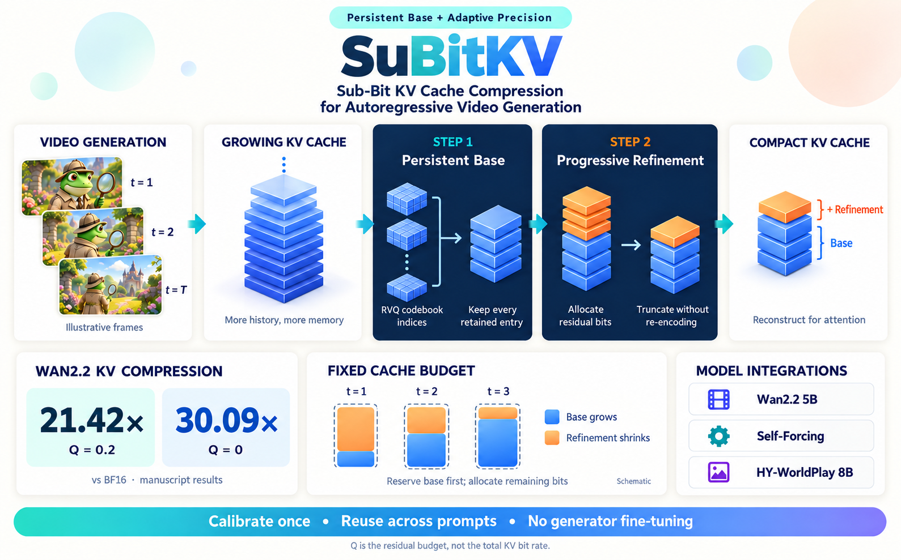

<h1 align="center">SuBitKV</h1>
<p align="center"><strong>Sub-Bit KV Cache Compression for Autoregressive Video Generation</strong></p>

<p align="center">
  <a href="#quick-start"></a>
  <a href="docs/subitkv.md"></a>
  <a href="https://github.com/linbowen0719-beep/ICLR2027_COMPRESS"></a>
</p>

<p align="center">
  
</p>

SuBitKV combines a **persistent base** with **adaptive precision** to compress
video KV caches, reaching **21.42× compression at Q=0.2** on Wan2.2.

## Highlights

- Retain cached history; truncate residual detail without re-encoding.
- Calibrate once, reuse across prompts and budgets. No generator fine-tuning.
- Integrations for **Wan2.2 5B**, **Self-Forcing**, and **HY-WorldPlay 8B**.

## Installation

Linux, NVIDIA CUDA GPU, Python 3.12, and PyTorch 2.8.0.

```bash
git clone https://github.com/linbowen0719-beep/SuBitKV.git
cd SuBitKV
conda create -n subitkv python=3.12 -y
conda activate subitkv
pip install -e '.[release]'
conda install -c conda-forge ffmpeg -y
```

[Attention backends and environment setup →](docs/installation.md)

## Quick start

Use the same `--model`, `--config` and `--run-id` for these three commands.
The default run ID is `moviegen-main`. All commands preview their work unless
`--execute` is supplied.

**1. Offline calibration:** download models, capture the 20 calibration prompts,
train K/V codebooks, fit routing and residual parameters, measure attention
statistics and generate every Q schedule.

```bash
python scripts/calibrate.py --model wan2_2_5b --execute
```

**2. Single inference:** generate exactly one video using the completed assets.
This command does not calibrate or generate a BF16 reference automatically.

```bash
python scripts/infer.py --model wan2_2_5b --prompt "A frog detective examining clues" --budget 0.5 --execute
```

Use `--method bf16`, `--method kivi_int2`, etc. to select another method.
`--budget` is for SuBitKV; `--seed` and `--output-dir` are optional.

**3. Main table:** reuse completed offline assets, generate all methods on both
**test 10** and **validation 973**, run PSNR/SSIM/LPIPS/TWE/VBench and export
`main_table.csv` and `main_table.json`. Missing assets cause an error; this
command never starts calibration.

```bash
python scripts/generate_table.py --model wan2_2_5b --execute
```

The fixed **calibration 20 / test 10 / validation 973** dataset row IDs and
hashes are stored in `assets/moviegen/splits.json`. No pretrained schedule
statistics are shipped. Completed artifacts are verified and reused on restart.
KV compression includes physical payload and metadata, shared parameters and
measured codec workspace; whole-process GPU peak is separate.

### HY-WorldPlay first frames

The preparation script downloads the official MovieGen generated-video parquet
shards on demand and extracts frame zero into the same three split directories.
Images and videos are not included in this repository and are not downloaded
by calibration/table commands.

```bash
# Before HY offline calibration:
python scripts/prepare_moviegen_frames.py --splits calibration --execute
python scripts/calibrate.py --model hyworldplay_8b --execute
# Before generating HY tables:
python scripts/prepare_moviegen_frames.py --splits test validation --execute
python scripts/generate_table.py --model hyworldplay_8b --execute
# Single HY inference accepts an explicit image:
python scripts/infer.py --model hyworldplay_8b --prompt "A lakeside cabin" --image path/to/image.png --budget 0.5 --execute
```

Install `.[moviegen]` (included in `.[release]`) and ffmpeg for preparation.
Downloads are cached at an immutable dataset revision; per-image receipts
verify dataset row, source video and image hashes. Use `--local-only` with
`--dataset-root` for existing parquet files, or `--indices 0` to prepare only
one within-split image. Video shards can be large even for a small image subset.
[Official MovieGen dataset](https://huggingface.co/datasets/meta-ai-for-media-research/movie_gen_video_bench).

[Configuration and details →](docs/subitkv.md) · [Read the code →](docs/repo_layout.md)

### Baselines

KIVI-style, TurboQuant and QuantVideo INT2/INT4 codecs are included, with native
model launch support. Install `pip install -e '.[baselines]'` for TurboQuant's
SciPy tables. After downloading model checkpoints, run for example:

```bash
python scripts/run_subitkv.py infer --model wan2_2_5b --run-id wan-demo --baseline kivi_int2 --resume --execute
```

Replace `kivi_int2` with `kivi_int4`, `turboquant_int2`, `turboquant_int4`,
`quantvideo_int2` or `quantvideo_int4`. Baselines need no SuBitKV calibration
bundle. KIVI compresses all completed spans without a recent-token BF16 window;
QuantVideo uses the restored online K-means and Triton residual packing path.
[Baseline implementation and validation details →](docs/baselines.md)

## Results

**Wan2.2-5B.** Quality: 973 samples.

| Method | Setting | KV compression ↑ | LPIPS ↓ | TWE ↓ |
| --- | --- | ---: | ---: | ---: |
| BF16 | Reference | 1.00× | — | 0.0173 |
| QuantVideo | INT2 | 4.77× | 0.473 | 0.0230 |
| KIVI | INT2 | 5.33× | 0.388 | 0.0193 |
| TurboQuant | K2/V2 | 7.31× | 0.589 | 0.0264 |
| **SuBitKV** | **Q=0.5** | **14.98×** | **0.276** | **0.0190** |
| **SuBitKV** | **Q=0.2** | **21.42×** | **0.327** | **0.0194** |
| **SuBitKV** | **Q=0** | **30.09×** | **0.416** | **0.0244** |

`Q` denotes residual bits; compression includes the persistent base, shared
codebooks, metadata, and cache-related workspace. [Manuscript protocol and figures →](assets/paper/README.md)

<p align="center">
  <a href="assets/paper/wan_temporal_comparison.pdf"></a>
</p>

## Acknowledgements

Built on
[QuantVideoGen](https://github.com/svg-project/Quant-VideoGen),
[HY-WorldPlay](https://github.com/Tencent-Hunyuan/HY-WorldPlay),
[Wan](https://github.com/Wan-Video/Wan2.2), and
[Self-Forcing](https://github.com/guandeh17/Self-Forcing).
[License](LICENSE) · [Third-party notices](subitkv/_vendor/README.md) · [Code guide](docs/repo_layout.md)
