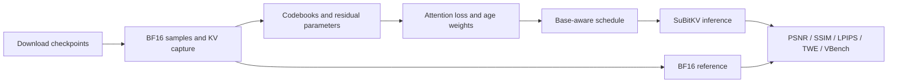

# Read the code

Start with the workflow, then follow the stage you want to change.

```text
scripts/                     Two CLI wrappers
configs/subitkv.yaml          Prompts, models, budgets, and hyperparameters
subitkv/
  pipeline/                  Download → collect → calibrate → infer → metrics
  models/                    Wan, Self-Forcing, and HY-WorldPlay adapters
  _vendor/                   Required upstream model code and licenses
  compress.py                Encode a persistent base and admit its residual
  temporal_adaptive_residual.py
                             Apply the schedule and truncate old residuals
  uncompress.py              Reconstruct K/V for attention
  rvq.py                     Persistent base encoding and decoding
  frame_mean_gaussian.py     K residual codec
  progressive_sign_adaptive_absmax_scalar.py
                             V residual codec
  cache_budget.py            Subtract accumulated base bytes from capacity
  kernels/                   CUDA/Triton implementations
tests/                       Workflow, budget, codec, and numerical tests
```

## Follow one run



The entrypoint is `pipeline/workflow.py`. `pipeline/adapters.py` manages run
artifacts and invokes the matching model adapter in `models/`. Each model runs
in its own process; common compression code remains independent of the model.

## Calibration and scheduling

`pipeline/calibration.py` calls the codebook trainer, residual fitting, and live
attention calibration. These functions use training prompts only. Calibration
saves the bundle consumed by inference; evaluation prompts do not select it.

`cache_budget.py` reserves the persistent bases admitted so far before converting
remaining bytes into residual bit counts. `pipeline/scheduling.py` implements
sequential DP and joint MILP. `pipeline/schedule.py` exposes the bundled-constant
DP command, which needs only Python.

## Cache lifecycle

`compress.py` encodes each new base once. The temporal module keeps that base
fixed while truncating K and V residual prefixes according to the schedule.
B16 keeps the original BF16 tensor; B0 keeps only the persistent base.
`uncompress.py` reconstructs chronological cache segments for attention.

The shared scalar and Hadamard helpers support the two residual codecs. The
vendored models contain the hooks that collect KV tensors and apply compressed
history at the model's attention boundary. Upstream authorship and licenses are
listed in [third-party notices](../subitkv/_vendor/README.md).

## Tests

```bash
python -m pytest -q
python -S scripts/subitkv_schedule.py --budget 0.5
```

CUDA tests skip when CUDA is unavailable. Model weights are needed only for
actual video generation, not the unit tests. Generated checkpoints, KV dumps,
videos, and reports belong in ignored local output directories.
